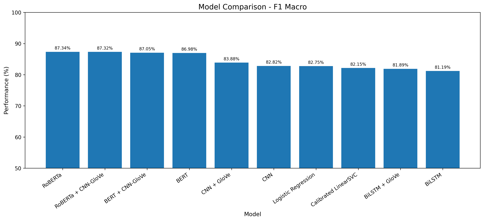
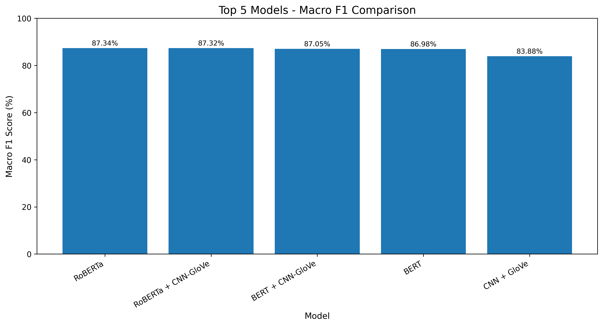

# Multiclass Cyberbullying Detection Using Machine Learning and Deep Learning

## Project Overview

This project investigates the application of Machine Learning (ML), Deep Learning (DL), Transformer-based models, and ensemble learning techniques for automated multiclass cyberbullying detection in English-language social media text.

The main objective is to classify social media posts into six categories:

- Age
- Ethnicity
- Gender
- Not Cyberbullying
- Other Cyberbullying
- Religion

The project compares traditional machine learning approaches, neural network architectures, pretrained language models, and soft-voting ensembles to evaluate their effectiveness in identifying different forms of cyberbullying.

## Classification Categories

| Label | Description |
|---|---|
| Age | Cyberbullying related to age |
| Ethnicity | Cyberbullying related to ethnicity |
| Gender | Cyberbullying related to gender |
| Not Cyberbullying | Non-cyberbullying content |
| Other Cyberbullying | Cyberbullying that does not fit the other specific categories |
| Religion | Cyberbullying related to religion |

## Models and Approaches

The project evaluates the following ten experimental configurations.

### 1. Traditional Machine Learning

- TF-IDF + Logistic Regression
- TF-IDF + Calibrated Linear Support Vector Classifier (LinearSVC)

### 2. Deep Learning

- Convolutional Neural Network (CNN)
- CNN with pretrained GloVe word embeddings
- Bidirectional Long Short-Term Memory (BiLSTM)
- BiLSTM with pretrained GloVe word embeddings

### 3. Transformer-Based Models

- BERT (`bert-base-uncased`)
- RoBERTa (`roberta-base`)

### 4. Ensemble Learning

Two soft-voting ensemble configurations are evaluated:

- BERT + CNN-GloVe (60% BERT + 40% CNN-GloVe)
- RoBERTa + CNN-GloVe (60% RoBERTa + 40% CNN-GloVe)

## Dataset and Preprocessing

The experiments use an English-language cyberbullying dataset.

The dataset is divided into training, validation, and testing subsets using a fixed stratified split:

| Subset | Percentage |
|---|---:|
| Training | 68% |
| Validation | 12% |
| Testing | 20% |

The same prepared splits are used across the experiments to support a consistent model comparison.

Text preprocessing includes:

- Lowercasing and text normalization for traditional ML and neural network models.
- URL and HTML removal.
- Tokenization and numerical text representation.
- TF-IDF feature extraction for traditional ML.
- GloVe word embeddings for embedding-based neural networks.
- Tokenizer-based encoding for transformer models.

## Experimental Results

The models are evaluated using:

- Accuracy
- Macro Precision
- Macro Recall
- Macro F1-score
- Weighted F1-score
- Macro ROC-AUC (One-vs-Rest)

### Model Performance Comparison

| Model | Accuracy | Macro F1 | ROC-AUC |
|---|---:|---:|---:|
| Logistic Regression | 82.78% | 82.75% | — |
| Calibrated LinearSVC | 82.25% | 82.15% | — |
| CNN | 83.10% | 82.82% | 96.82% |
| CNN + GloVe | 84.18% | 83.88% | 97.23% |
| BiLSTM | 82.03% | 81.19% | 96.39% |
| BiLSTM + GloVe | 82.51% | 81.89% | 96.87% |
| BERT | 87.05% | 86.98% | 97.93% |
| **RoBERTa** | **87.60%** | **87.34%** | **98.03%** |
| BERT + CNN-GloVe | 87.16% | 87.05% | 97.92% |
| RoBERTa + CNN-GloVe | 87.59% | 87.32% | 97.97% |

*ROC-AUC values for Logistic Regression and Calibrated LinearSVC are not included in this comparison because they have not yet been added to the consolidated metrics.*

### Best Performing Model

RoBERTa achieved the strongest overall individual-model performance:

- Accuracy: **87.60%**
- Macro Precision: **87.74%**
- Macro Recall: **87.56%**
- Macro F1-score: **87.34%**
- Macro ROC-AUC: **98.03%**

The RoBERTa + CNN-GloVe ensemble achieved 87.59% accuracy and 87.32% Macro F1, performing very close to standalone RoBERTa.

### Performance Visualizations

The following figures provide a visual comparison of the evaluated models.

#### Accuracy Comparison


#### Macro F1 Comparison



#### Weighted F1 Comparison


#### Top 5 Models by Macro F1



## Project Structure

```text
multiclass-cyberbullying-detection/
│
├── notebooks/
│   └── EN_Multiclass1.ipynb
│
├── src/
│
├── tests/
│
├── data/
│
├── results/
│   ├── figures/
│   ├── metrics/
│   ├── models/
│   ├── ML_Multiclass_80_20/
│   ├── CNN_Multiclass_80_20/
│   ├── CNN_GloVe_Multiclass_80_20/
│   ├── BiLSTM_Multiclass_80_20/
│   ├── BiLSTM_GloVe_Multiclass_80_20/
│   ├── BERT_Multiclass_80_20/
│   ├── RoBERTa_Multiclass_80_20/
│   ├── Soft_Voting_Ensemble_BERT_CNN_GloVe/
│   └── Soft_Voting_Ensemble_RoBERTa_CNN_GloVe/
│
├── README.md
├── requirements.txt
└── .gitignore
```

## Technologies Used

- Python
- Pandas and NumPy
- Scikit-learn
- TensorFlow / Keras
- PyTorch
- Hugging Face Transformers
- NLTK
- Matplotlib and Seaborn
- GloVe pretrained word embeddings
- Google Colab
- Google Drive

## Reproducibility

The experiments were developed and executed using Google Colab.

To reproduce the experiments:

1. Clone or download the repository.
2. Install the required Python dependencies.
3. Obtain and prepare the dataset.
4. Configure the dataset and project paths.
5. Open the notebook in Google Colab or Jupyter.
6. Execute the notebook cells in the documented order.

The original dataset and large pretrained model artifacts are not included in the GitHub repository. Users must obtain the dataset and pretrained resources separately.

## Limitations

- The experiments focus on English-language text.
- Classification performance depends on the dataset and its annotation quality.
- Some categories, particularly Not Cyberbullying and Other Cyberbullying, remain more challenging to distinguish.
- Model predictions should not be treated as definitive judgments of harmful intent.
- Performance on other platforms, languages, and real-world data may differ.

